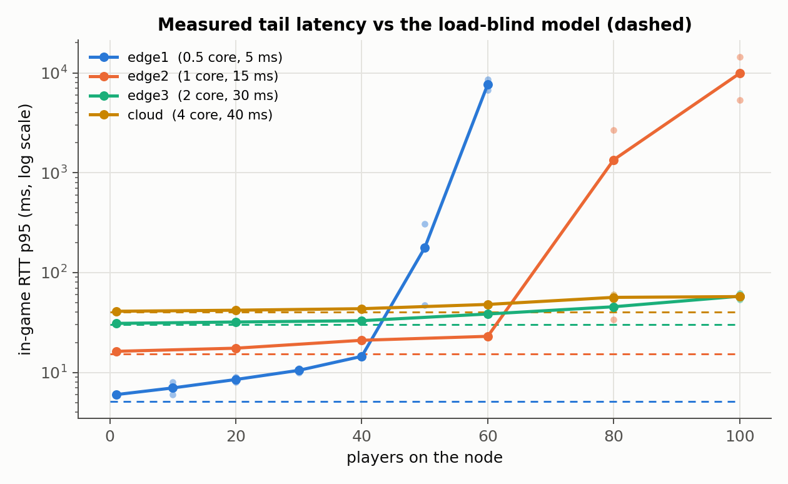
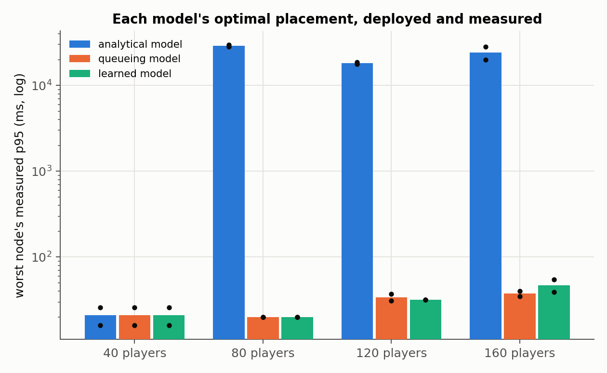

# Latency-Aware Edge Game Server Placement

Ankam Charan Teja, Aranya Roy, Nikhil Kumar Reddy, Yashvardhan Deep, Akshit Singh

Edge placement algorithms usually pick a node with an analytical latency model:

```
latency = propagation_delay + data_size / bandwidth
```

The model knows about distance and bandwidth, but nothing about how loaded the
server is. Edge nodes are small. Once a node gets crowded, the queueing delay
inside the server can exceed the network delay that edge placement was supposed
to save. And since these algorithms are almost always evaluated in simulators
built on the same model, the error never shows up.

Server load is not ignored in practice - it is just wired to a different job
than placement latency. Autoscalers and load balancers read it as a *threshold*
(scale out, or route away, when CPU crosses a line). Cost models read it as a
roughly *linear* billing term. Queueing-aware placement does put a delay term in
the objective, but from an *analytical* M/M/1-style model, not from measurement.
In every one of these the load→latency relationship is either reacted to after
the placement decision or assumed in closed form - never learned from a real
workload and fed back into the placement ranking itself. This project targets
exactly that seam, for tail-sensitive interactive workloads (gaming), where the
tail latency (p95) the analytical model omits is the number that actually decides whether the
placement was any good.

This repo measures that error on a real (emulated) testbed: an edge-cloud
topology built with Containerlab, running an actual Minecraft (Paper) server
under strict CPU limits, with load generated by protocol-level bot clients
(mineflayer).

**In one minute.**

- On a 0.5-core edge node, ICMP stays within 0.3 ms of 5 ms at any load, while
  the in-game p95 goes from 6 ms at 1 player to 6.7-8.6 s at 60.
- Deployed for real, the load-blind formula's placements leave the worst
  players waiting 18-30 s from 80 players on. Load-aware placements keep the
  same players at 20-39 ms.
- A model fitted on two measured grid replicates predicts best: median
  error 0.9 ms (1.2 ms on a held-out replicate), against 1.8 ms for a fitted
  M/M/1 model and 5.8 ms for the formula.
- Run as a live controller on the same schedule of players, the formula
  never moves a match (median worst-player p95 1 058 ms), M/M/1 overloads a
  node its utilization-only curve rates as fine (166 ms), and the learned
  model holds 33 ms. When a node silently loses half its CPU, only a model
  that keeps correcting itself from measurements moves players off it.

Read next: the paper ([report/main.pdf](report/main.pdf)), the analysis and its
limits ([docs/08-results.md](docs/08-results.md),
[docs/09-live.md](docs/09-live.md)), and
[a replay of the live dashboard](https://ankamteja.github.io/latency-aware-edge-game-placement/).

## Method

The same network path is measured at four depths, concurrently, under the same
load - so the delay can be attributed to a layer instead of guessed at:

| Probe | Path it exercises |
|---|---|
| **ICMP ping** | kernel to kernel - network only. This is what the analytical model predicts. |
| **TCP handshake** | network + the server host's accept path |
| **server status ping** | network + the server process answering a request |
| **in-game RTT** | network + the server's single main game thread (chat echo, via mineflayer) |

The gap between the first and the last is model error. If ICMP stays flat while
in-game RTT climbs, the extra delay is server-side queueing - the term the
formula has no place for - and it is not the emulated link or the load
generator. Alongside these, the server's own counters (MSPT, TPS, container
CPU, player count) are sampled throughout, so the cause is recorded next to the
effect. Details in [docs/04-metrics.md](docs/04-metrics.md).

## Positioning

The pieces already exist - separately. Server load is measured everywhere; it is
just never assembled into a *measured* load→latency term inside the placement
decision:

| System | Reads load as | Acts | Predicts latency? |
|---|---|---|---|
| Autoscaler | threshold (CPU > X) | after placement | no |
| Load balancer | relative (least-load) | per request, after placement | no |
| Cost / billing model | ~linear utilization term | accounting | no |
| Queueing-aware placement | analytical M/M/1 delay | at placement | modeled, not measured |

Two reasons the join is missing. First, the load→latency curve is nonlinear and
tail-heavy - delay grows like `1/(1 − utilization)`, flat until the node is
nearly saturated, then vertical - so it does not drop cleanly into a closed-form
placement objective, and the simulators used to evaluate placement inherit the
same load-blind model. Second, cloud nodes rarely saturate (you autoscale first),
so the coupling stayed invisible; edge nodes are small and capped and have little room to
scale out, so queueing delay resurfaces exactly where placement is supposed to
help.

**Novelty, stated narrowly (and defensibly):** learn the load→latency curve
*empirically* from a real interactive workload, then use it as the latency term
that *ranks* candidate nodes - rather than reacting to load after placement, or
assuming its shape in closed form. The claim is not "nobody uses load"; it is
that we found no placement work that measures the load→latency relationship
for a tail-sensitive interactive workload and puts it into the placement
ranking.

The measurements show the omitted term is not a correction but the dominant
one: on the 0.5-core node the in-game p95 is 6 ms at 1 player and 14.5 ms at
40, then 6.7-8.6 s at 60, while ICMP never moves more than 0.3 ms (grid
replicates 1 and 2, [docs/08 §8.2](docs/08-results.md)). A closed form fitted
to the flat part predicts nothing about the cliff.

## Layout

```
bots/         bot.js load generator, probe.js latency probes
topology/     containerlab edge-cloud testbed + bring-up/verify scripts
controller/   collect.sh (grid cells), deploy.sh (one placement, all nodes at once),
              grid.sh, deploy_plan.sh, warmup.sh, capacity.sh
dataset/      build_dataset.py - joins the raw streams into labelled rows
placement/    latency models, placement algorithms, the deploy-and-score experiment
model/        evaluate.py (prediction + ranking tests), metrics.py, figures.py
live/         real-time placement controller, dashboard, terminal load tool
tests/        unit tests for the live controller (python3 -m pytest -q tests)
data/         the measured dataset: dataset.csv (30 s windows), cells.csv
results/      raw measurement streams, model evaluation, deployment scores
figures/      generated figures for the write-up
docs/         full documentation, written for a beginner
```

## The testbed

```
   client ──eth1── 10.0.1.0/30 ──── edge1   0.5 core    5.16 ms RTT
     bots ──eth2── 10.0.2.0/30 ──── edge2   1 core     15.24 ms
   probes ──eth3── 10.0.3.0/30 ──── edge3   2 cores    30.25 ms
          ──eth4── 10.0.4.0/30 ──── cloud   4 cores    40.22 ms
```

Four candidates, so the question is a *ranking*, not an A/B. Which IP the bots
dial is the placement decision.

Capacity is structural (it needs a redeploy, so it lives in the topology);
distance is a runtime knob - `./netem.sh ladder` gives the realistic tradeoff
where the closest node is the weakest, `./netem.sh flat` puts every edge at the
same distance so capacity can be isolated from distance, with no redeploy.

Every number above is measured with `ping` (`placement/nodes.json`, the values
every model uses; Table I of the report rounds them), 0% loss, mdev < 0.1 ms -
never the configured value.

## Running it

Set the laptop's power mode to Performance first (docs/06 §6.19), then:

```bash
topology/up.sh                        # deploy, impair, verify: ALL CHECKS PASSED
cd controller && ./warmup.sh          # generate terrain once, discard
./grid.sh grid1 && ./grid.sh grid2 reverse && ./grid.sh grid3   # ~3 h, host idle
cd .. && python3 dataset/build_dataset.py --tags grid1,grid2,grid3,place1
python3 -m model.evaluate && python3 -m model.metrics && python3 -m model.uncertainty
live/run.sh                           # live dashboard on http://127.0.0.1:8090
python3 -m pytest -q                  # 26 tests
```

The full chain, including the deployed placements, is in
[docs/08 §8.7](docs/08-results.md); the live runs in
[docs/09 §9.5](docs/09-live.md).

`warmup.sh` is not optional. A freshly copied world makes a healthy node look
saturated, because the server is *generating* terrain rather than simulating
it - and it biases the weakest node hardest. Cold vs warm, same node and load:
p95 474 ms vs 60 ms.

`up.sh` refuses to hand over a testbed that does not verify - CPU caps read
from `/sys/fs/cgroup/cpu.max`, netem qdiscs present, and the RTT actually
measured with `ping`. Full procedure in [docs/05-runbook.md](docs/05-runbook.md);
every command explained in [docs/03-commands.md](docs/03-commands.md).

## Results

Full analysis, numbers and limits: [docs/08-results.md](docs/08-results.md).
The paper, as a PDF: [report/main.pdf](report/main.pdf) (also attached to the
[release](https://github.com/ankamteja/latency-aware-edge-game-placement/releases/tag/report-2026-10-21)).
Four nodes (0.5 / 1 / 2 / 4 cores at 5 / 15 / 30 / 40 ms), two replicates of
the load grid to fit on and a third held out to test on, then each latency
model's optimal placement deployed for real.

**The load-blind placement fails, by orders of magnitude.** Each model chose
how to split a batch of players across the four nodes; every choice was then
deployed and measured with all nodes loaded at once. Worst node's p95 in-game
RTT, ms:

| players | analytical (load-blind) | queueing (M/M/1) | learned (trees) |
|---|---|---|---|
| 40 | 26 | 26 | 26 |
| 80 | **29 897** | 20 | 20 |
| 120 | **17 758** | 31 | 32 |
| 160 | **19 990** | 35 | 39 |

The analytical model predicted 5-15 ms for every one of those and filled the
nearest node to its 100-player cap before using the next. Both load-aware models keep edge1 at 40 players and spread
the rest; their placements measure within a few ms of each other.

**The network is flat; the game thread is not.** ICMP never moved more than
0.3 ms from its configured value in any cell. edge1's p95 stays within 10 ms of
its 5 ms RTT up to 40 players and is 6.7-8.6 s at 60; edge2 has its knee at 80
and every replicate breaks by 100. The tail leaves the flat region while mean tick time is still an
eighth of its budget.

**The learned model is the better predictor** (cross-replicate median error
0.9 ms vs 1.8 ms queueing and 5.8 ms analytical; on the held-out third
replicate 1.2 / 2.3 / 6.9 ms), but on these four scenarios it does not *place*
better than a correctly fitted closed form. One host, three replicates, capacities chosen rather than discovered - see
[§8.6](docs/08-results.md#86-limits---quote-these-with-the-results).




## Live controller

The same models drive a real-time controller on the testbed (`live/`,
[docs/09-live.md](docs/09-live.md)): every 2 s it reads every bot's latency
and every server's counters, every 10 s it may move one match of ten players,
and a dashboard on `http://127.0.0.1:8090` shows the twin, the raw telemetry
and every model's prediction as it happens. **Watch it without the testbed:**
[a replay of the recorded runs](https://ankamteja.github.io/latency-aware-edge-game-placement/)
plays the same dashboard back from the run logs (`python3 -m live.build_site`).
Load is driven from a terminal
(`live/load.sh join 40`, `add edge1 30`, `throttle edge1 0.25`, ...), and
`live/demo.sh` runs the whole demonstration one step per Enter. To show it to
someone, follow [the demo guide](docs/demo-guide/guide.pdf).

| run, worst node's p95 | median | time over 100 ms | moves |
|---|---|---|---|
| same 13-min schedule, load-blind controller | 1 058 ms | 53% | 0 |
| same 13-min schedule, queueing (M/M/1) controller | 166 ms | 53% | 11 |
| same 13-min schedule, learned controller | 33 ms | 18% | 10 |
| edge1's CPU halved mid-run, queueing / learned (offline), 3 runs, whole run | 0.5-7.7 s | 74-83% | 4 |
| edge1's CPU halved mid-run, learned corrected live, 2 runs, whole run | 24-43 ms | 2-14% | 8-12 |

The load-blind controller never moves a match. Queueing, whose curve depends
on utilization alone, loads edge2 to 80 players, past its knee; the learned
model stops at 70. Neither offline model notices a node that silently got
slower; a model that keeps correcting itself from measurements does. Runs are
single or paired; read [§9.6](docs/09-live.md) for what each number does and
does not show.


## Earlier results (superseded or background)

### Measured node capacity (warm worlds, 2026-08-11; day/night cycle was running)

Players a node holds before its tick time breaks the 50 ms budget that the
game's 20 Hz design imposes. This is the denominator that turns a raw player
count into *utilization*, the unit `1/(1 − utilization)` is written in and the
only one comparable across nodes of different size.

| node | CPU | measured RTT | N_max | MSPT at N_max | first breach |
|---|---|---|---|---|---|
| edge1 | 0.5 core | 5.10 ms | **50** | 44.5 ms | 60 bots → 69.1 ms |
| edge2 | 1 core | 15.29 ms | **100** | 44.7 ms | none ≤ 100 |
| edge3 | 2 cores | 30.27 ms | > 100 | 11.1 ms | none ≤ 100 |
| cloud | 4 cores | 40.29 ms | > 100 | 9.3 ms | none ≤ 100 |

Capacity scales at roughly **100 players per core**, and every node's tick time
turns vertical exactly where its CPU reaches its own quota - flat, then a knee,
then a cliff. edge1: 8 → 40 players moves MSPT only 6.9 → 16.5 ms; 40 → 60
takes it to 69.1 ms. ICMP RTT never moved across any of it.

edge3 and cloud never saturate: the 100-player ceiling is the testbed's
(`max-players`, and the load generator), not theirs.

### Two-node testbed - the model's ranking inverts

> **Superseded.** The run below is confounded by cold-world chunk generation -
> see the correction in [results/sweep.md](results/sweep.md). The inversion is
> still expected, but its magnitude and the player count at which it appears
> are being re-measured on warm worlds. Treat the table as historical.

p95 in-game RTT (ms), edge at 5.1 ms network distance and 0.5 core, cloud at
40.1 ms and 4 cores. Every cell held its full player count with zero kicks.

| bots | 1 | 5 | 10 | 20 | 30 | 40 |
|---|---|---|---|---|---|---|
| **edge** p95 | 11 | 18 | 71 | 3753 | 3942 | 6248 |
| **cloud** p95 | 43 | 43 | 44 | 82 | 138 | 310 |
| model's pick | edge | edge | edge | edge | edge | edge |
| measured winner | edge | edge | **cloud** | **cloud** | **cloud** | **cloud** |

The analytical model ranks by distance alone, so it picks edge at every load,
by a fixed 35 ms. From 10 players on it is picking the worse node - by 45× at
20 players. Meanwhile ICMP RTT on the same links never moved: 5.07–5.10 ms and
40.10 ms in every cell, saturated or idle. The cause sits next to the effect in
the same data: edge CPU pins at its 0.5-core cap from 30 bots, and MSPT crosses
the 50 ms tick budget between 30 and 40 - exactly where latency becomes seconds.

One run, one host, with capacities chosen rather than discovered. It is first
evidence, not the analysis. Full table and caveats:
[docs/04-metrics.md](docs/04-metrics.md).

### Single-node sweep - the term the model omits

Full load sweep, single server on localhost, only the bot count changed
(so network distance is fixed at zero):

| ms  | 1 bot | 5 | 10 | 20 | 30 | 40 |
|-----|-------|---|----|----|----|----|
| p50 | 2     | 3 | 3  | 4  | 8  | 40 |
| p95 | 15    | 51| 54 | 63 | 95 | 224 |
| p99 | 81    | 75| 929*| 274| 398| 583 |
| max | 81    | 133| 1306*| 603| 704| 1241 |

The analytical model predicts an identical latency for every column, because
distance and bandwidth never move, so the growth is all server-side.

**But the magnitudes here are confounded** and should not be quoted: every run
started from a freshly copied world and the grid ramped upward, so each cell
pushed bots into terrain the previous ones never reached. The server was
*generating* chunks as well as simulating players, and the amount of generation
rose together with the player count. On a warm world the same 0.5-core node
holds 50 players before breaking the tick budget - it was not close to
saturated at 40. Full correction in [results/sweep.md](results/sweep.md);
the artefact and its fix in
[docs/06-troubleshooting.md §6.2b](docs/06-troubleshooting.md). Earlier de-risk:
[results/derisk.md](results/derisk.md).

## Environment

| | |
|---|---|
| server | Paper 1.21.4 (`itzg/minecraft-server`) |
| mineflayer | 4.37.1 |
| node | v22.22.2 |
| host | Fedora, i7-14700HX, 16 GB RAM |

## Roadmap

- [x] Single-node localhost baseline (bot RTT under load, fixed zero network)
- [x] Concurrent network probes, to measure the network vs server split per run
- [x] Containerlab edge-cloud topology with two capped nodes at different
      emulated distances
- [x] Automated sweep across bot counts and placement targets
- [x] Four-candidate testbed with a capacity ladder (0.5 / 1 / 2 / 4 cores)
- [x] Per-node capacity measured, so load can be expressed as utilization
- [x] Warm re-run of the placement grid, two replicates, time of day frozen
- [x] Third replicate held out from every fit, scored with every model
- [x] Labelled dataset (`data/dataset.csv`, `data/cells.csv`)
- [x] Latency predictor trained on measured data, compared against the
      analytical and M/M/1 models on prediction and on node ranking
- [x] Each model's placement deployed for real and measured
- [x] Bootstrap confidence intervals on the offline model scores
- [x] Real-time placement controller with a dashboard, run under each model on
      the same schedule, plus a node that silently loses half its CPU
- [x] A model corrected from live measurements, with unit tests
- [x] A hosted replay of the dashboard, built from the run logs
- [ ] More replicates and a dedicated host, to put intervals on the knees
- [ ] Larger placement problems (more nodes, more matches) where the
      load-aware models could disagree

## Reading the results

Two generations of data live under `results/`:

- `results/raw/*.log` - the single-node sweeps, bot RTT only, one file per run.
  Written up in [sweep.md](results/sweep.md) and [derisk.md](results/derisk.md).
- `results/raw/<tag>/<target>-<N>bots/` - the two-node testbed. Four raw
  streams per cell (`bot.csv`, `probe.csv`, `icmp.txt`, `server.csv`) plus a
  `meta.json` recording the CPU cap, the netem delay, the player count actually
  held, and the exact millisecond boundaries of the idle and steady windows.

Nothing is aggregated at collection time - see
[docs/04-metrics.md](docs/04-metrics.md) for why, and for how to read a run
with nothing but `grep` and `sort`.

## Documentation

[docs/](docs/) covers the project from zero: the concepts
([01](docs/01-concepts.md)), the testbed ([02](docs/02-topology.md)), every
shell command ([03](docs/03-commands.md)), the measurement design
([04](docs/04-metrics.md)), the runbook ([05](docs/05-runbook.md)), every
failure hit so far with its fix ([06](docs/06-troubleshooting.md)), node
capacity ([07](docs/07-capacity.md)), the results and their limits
([08](docs/08-results.md)), and the live controller
([09](docs/09-live.md)). To show the system to someone, follow the demo
guide: [docs/demo-guide/guide.pdf](docs/demo-guide/guide.pdf).

## License

MIT - see [LICENSE](LICENSE).
