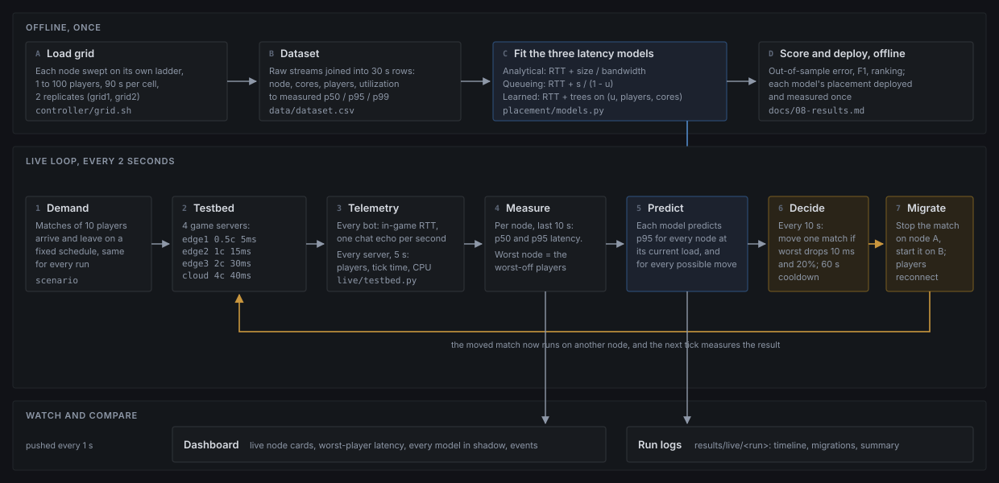
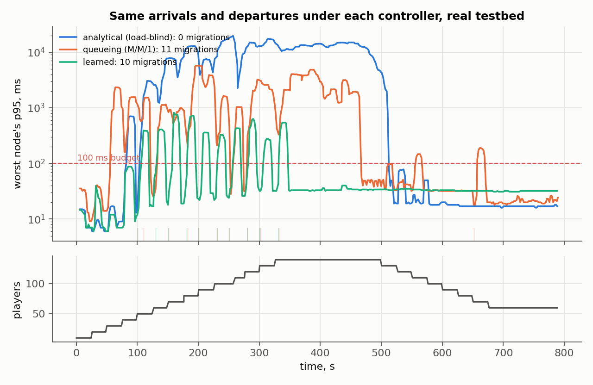
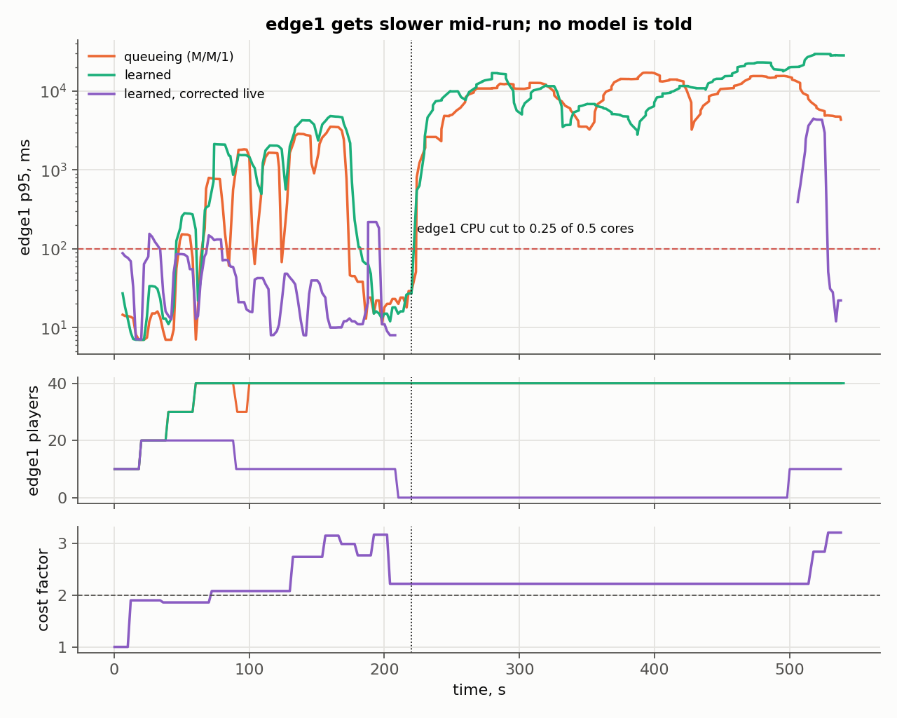

# 9. The live controller and its dashboard

Chapters 1 to 8 measure the testbed and grade three latency models. This one
closes the loop: a controller reads the testbed in real time, asks a latency
model where each match should be, moves matches between nodes, and a
dashboard shows every step as it happens. It is a digital twin in the
practical sense: a live model of the four nodes, fed by measurements every
two seconds, that the controller acts on.



---

## 9.1 What runs

```
live/
  testbed.py    start and stop matches, read server counters, tail latency CSVs
  policy.py     where a match should be, according to one latency model
  controller.py the real-time loop, the scenarios, the run logs
  server.py     FastAPI: dashboard, WebSocket state, run and load control
  static/       the dashboard (one HTML page, no external scripts)
  run.sh        start the console          live/run.sh
  load.sh       operator load from a shell live/load.sh add edge1 40
  ab.sh         old model against ours     live/ab.sh standard
  status.py     the live state as a table  live/load.sh status
```

**A match** is ten bots in one `bot.js` process in the client container,
tagged `live-mNN` on its command line. Match `N` uses usernames
`bot<10N>` to `bot<10N+9>`; bot0 to bot159 are opped on every server, so up
to 16 matches can run at once.

**A migration** stops that process, waits until it has exited, and starts it
again pointed at the other node. The ten players disconnect from one server
and log in to the other, the same cost a real session move has. The
controller measures it: the reconnect time of a move is from the stop until
the last of the ten players sends its first latency sample on the new node.

**The controller's model** is one of four, chosen per run:

| policy | what it predicts a node's p95 from |
|---|---|
| `analytical` | distance only: the load-blind formula of chapter 8 |
| `queueing` | the fitted M/M/1 form: distance + s / (1 - u) |
| `learned` | the gradient-boosted trees fitted on `grid1` and `grid2` |
| `learned-live` | `learned`, corrected while it runs: each steady 10 s window is compared with the prediction and updates a per-node cost factor c (the node at P players behaves like the grid's node at c x P), and a window measured over 100 ms is remembered for 5 minutes as a floor for that node at that load or more |

All four are evaluated in the background on every run (*every model in
shadow*), whichever one is in control.

## 9.2 One tick, every 2 seconds

1. **Demand.** Apply the scenario: matches arrive and leave on a fixed
   schedule, identical for every run, or, in a manual session, whatever the
   operator queued with `live/load.sh` or the dashboard.
2. **Telemetry.** Read every bot's new latency samples (one chat echo per bot
   per second, written as CSV by `bot.js`). Every 5 s also read every server's
   player count (`rcon list`), tick time (`rcon mspt`) and CPU (the
   container's own cgroup counter).
3. **Measure.** Per node, p50 and p95 of the last 10 s of samples. The worst
   node's p95 is the worst-off players' latency, the number the controller
   tries to keep low.
4. **Predict.** Every model (analytical, queueing, learned) predicts p95 for
   every node at its current player count. Only the model in control acts;
   the other two are scored in shadow.
5. **Decide** (every 10 s). Consider moving each match to each other node.
   Take the single best move if it lowers the predicted worst p95 by at least
   10 ms and by 20 %, or, with the worst unchanged, lowers the players'
   average predicted p95 by 3 ms. A match that just moved stays put for 60 s.
6. **Migrate.** Stop the match on node A, start it on node B.
7. **Publish.** The state goes to the dashboard over a WebSocket once a second
   and to `results/live/<run>/` on disk.

The three gains in step 5 are hysteresis: without them a match would bounce
between two nodes on noise. They are in `live/policy.py` (`Gains`) and every
run records the values it used in `meta.json`.

## 9.3 Why the analytical controller never moves a match off a crowded node

The analytical model predicts a node's latency as its network round trip,
whatever the load. To it, edge1 is 5 ms at 1 player and at 100. A move off a
crowded node can never lower its prediction, so it never makes one; the only
moves it ever makes are toward a nearer node. This is not a setting, it is
what the formula implies, and it is exactly the behaviour of a placement
algorithm built on it.

## 9.4 Fair comparison

- **Same demand.** Every scenario is a fixed, seeded schedule.
- **Same starting point.** By default every new match lands on the nearest
  node with room (`arrival: nearest`), the way a distance-based matchmaker
  places it. Runs then differ only in the controller's model.
  `arrival: model` lets the model place new matches too.
- **Same gate.** A run starts only when every server reports zero players,
  the same rule every grid cell uses.
- **No contention.** `live/run.sh` pins the controller to cores 24 to 27,
  which no server (0 to 7) or the client (8 to 23) uses. Keep the host
  otherwise idle during a run (docs/08-results.md 8.6).
- **Scored the same way.** Shadow scores count one row per node per 10 s
  window, and only windows in which that node's load did not change, so a
  prediction is never graded against samples taken at a different load.

## 9.5 Running it

```bash
topology/up.sh                  # if the lab is not up; ends with ALL CHECKS PASSED
live/run.sh                     # dashboard on http://127.0.0.1:8090
```

**Watch the twin react to load you add from a terminal.** Everything is
driven from a shell; the dashboard only shows:

**The guided demo** walks through all of it, one step per Enter, with the
live table in between and a line on what to point at:

```bash
live/demo.sh                    # our model, then the load-blind formula (~12 min)
live/demo.sh ours               # only our model
live/demo.sh formula            # only the formula
```

**Or step by step:**

```bash
live/load.sh start learned-live # a manual session; models: learned-live, learned,
                                #   queueing, analytical
live/load.sh join 40            # 40 players arrive, one match every 5 s; the model
                                #   predicts every node and places each match
live/load.sh add edge1 30       # a flash crowd forced onto edge1; the controller
                                #   then moves matches off it
live/load.sh throttle edge1 0.25  # edge1 loses half its CPU, no model is told
live/load.sh restore edge1      # and gets it back
live/load.sh status             # players, tick, p95, the controller's prediction
live/load.sh remove 20          # take 20 players off
live/load.sh stop               # end the session, disconnect every bot
```

Tested on the testbed on 2026-10-21: with `learned-live`, `join 40` put four
matches on edge1 (predicted 7 to 14 ms each) and, once edge1 was predicted
past its knee, `join 30` went to edge2; `add edge1 30` was moved to edge3
within 36 s; after `throttle edge1 0.25` a match moved off within 25 s. With
`analytical`, `join 70` put all 70 players on edge1 ("predicted 5 ms") while
it measured 12.8 s.

The dashboard's *Raw telemetry* panel prints what the numbers are made of as
it reads them: latency lines from named bots (`bot23 rtt 7 ms`) and each
server's own console output (`rcon list: There are 40 of a max of 100 players
online: bot0, bot1, ...`). Each node card lists the usernames the server
itself reports online, next to the controller's own count.

Within one tick the twin shows edge1's player count jump; within a few
seconds its p95 rises and its link turns amber or red; within 10 s the
controller moves a match to edge2, drawn as a dot travelling along the links,
and the event log names the terminal as the source of the load. Run the same
commands with controller *Analytical* to see the formula leave everything
where it is.

**The old model against ours, on the same schedule:**

```bash
live/ab.sh standard             # about 30 minutes: analytical, then learned
```

Both runs appear on the *Compare runs* page.

## 9.6 Results

All runs on 2026-10-21, host in Performance power mode, logs in
`results/live/<run>/`. `python3 -m live.summarize` rebuilds every number
below into `results/live/summary.md`; `python3 -m live.figures` draws
figures 6 and 7.

### The standard schedule under each controller

The same arrivals and departures (a match of 10 every 25 s up to 140 players,
held 150 s, then down to 60), new matches landing on the nearest node with
room (a distance-based matchmaker), each controller free to move one match
every 10 s. **Three runs per controller**; every cell is the median over the
runs with [lowest, highest].

| controller | worst node's p95, median | worst p95, max | time over 100 ms | samples over 100 ms | all samples' p95 | migrations | mean reconnect |
|---|---|---|---|---|---|---|---|
| analytical (load-blind) | 1.1 s [76 ms, 4.5 s] | 29.8 s [19.6, 31.8] | 53% [46, 62] | 35.6% [33.6, 40.1] | 13.0 s [12.8, 14.6] | 0 | - |
| queueing (M/M/1) | 99 ms [72, 166] | 3.8 s [3.5, 5.7] | 50% [46, 53] | 15.3% [11.3, 25.7] | 756 ms [434 ms, 1.8 s] | 11 | 6.3 s [6.2, 6.3] |
| learned | 39 ms [33, 47] | 3.6 s [0.8, 5.8] | 33% [18, 41] | 7.9% [2.0, 10.3] | 338 ms [35, 729] | 10 | 6.1 s [5.9, 6.2] |
| learned, corrected live | **33 ms [32, 34]** | **918 ms [898 ms, 1.3 s]** | **8% [5, 11]** | **0.8% [0.8, 1.0]** | **35 ms [33, 35]** | 15 [15, 16] | 6.0 s [6.0, 6.2] |



Figure 6 shows each controller's median run.

- **The analytical controller never moves a match.** edge1 fills to 100
  players and its p95 is in the seconds for minutes: the offline placement
  result, reproduced in closed loop. In one run (`...173951655`) edge1's p95
  fell back to about 100 ms after 360 s with 100 players still assigned,
  while its tick time fell from 280 to 10-35 ms. The timeline records
  assigned players, not connected ones, so this is not confirmed, but it
  matches the deployments, where an overloaded edge1 kept only 63-71 of 100
  (bots time out). That run is why the analytical median spans 76 ms to 4.5 s.
- **Queueing moves as often as learned but to the wrong place, in every run.**
  Its curve depends on utilization alone, so it rates edge2 at 80 players
  (u = 0.8) at 27 ms. edge2's measured knee is at 80 players. In all three
  runs it loaded edge2 to 80, and edge2's p95 stayed above 1 s for 14 to
  174 s, peaking at 1.7-4.9 s. The learned model predicts 65 ms for edge2 at
  80, so in all three runs it stopped edge2 at 70 and sent the overflow to
  edge3. This is the "one curve is not enough" effect of 08 §8.2 deciding a
  placement. Offline, at the four deployed scenarios, the two models placed
  almost the same; here they do not.
- **The learned controller's time over budget is edge1 just below its knee.** Almost
  every tick over 100 ms (all of them in two runs, 150 of 159 in the third)
  is edge1 holding 40 players. The grid measured 14.5 ms there; live, with
  every node loaded, edge1 at 40 is often backlogged, as in the deployed
  placements (26 ms against 14.5 ms in the grid). The learned model has no
  way to see that, and the queueing runs share the same edge1 problem on top
  of edge2's.
- **The live-corrected model is the best of the four here.** It was run
  on the same schedule afterwards (three runs, about 90 min after the
  others, after grid4). It distrusts edge1 at 40 players (the same
  login-window caution described under the CPU cut below), so it moves more
  (15-16) and keeps edge1 lighter; its time over budget is a third of the
  offline learned model's and its worst moment under 1.3 s. The caution
  that confounds its capacity-drop runs is what helps it on this schedule.
- **Not every metric separates them.** The worst single moment (max) is in
  the seconds for both load-aware controllers and their ranges overlap;
  the medians, time over budget and share of samples over budget do not.

**Every model in shadow.** Each 10 s window of steady load on a node is also
scored against every model's prediction for it, made before the window was
seen. F1 for "this node is over 100 ms", median [lowest, highest] over the
three runs of each controller (91-137 windows per run, 7-36 of them over
100 ms):

| in control | analytical | queueing | learned | learned, corrected live |
|---|---|---|---|---|
| analytical | 0.00 | 0.87 [0.74, 0.87] | 0.87 [0.73, 0.88] | **0.94 [0.77, 0.95]** |
| queueing | 0.00 | 0.00 | 0.00 | **0.71 [0.65, 0.78]** |
| learned | 0.00 | 0.00 | 0.00 | **0.35 [0.25, 0.52]** |

Under the queueing and learned controllers the windows over budget are edge1
backlogged at 40 and edge2 at 80: loads every offline model calls healthy,
so all three score 0 in all six runs. Only the model that corrects itself
from the measurements catches some of them.

### A node gets slower and no model is told

`capacity-drop`: 8 matches arrive on the nearest node and stay; at 220 s
edge1's CPU quota is cut from 0.5 to 0.25 cores (`docker update`, the change a
noisy neighbour or a smaller VM makes) and nothing tells any model. The
change takes effect at 222-224 s; "after the cut" below starts there.
9 minutes per run.

| controller | runs | edge1's players just before the cut | time over 100 ms, whole run | after the cut: time over 100 ms |
|---|---|---|---|---|
| queueing | 3 | 40, 40, 40 | 83% [80, 85] | 100% [99, 100] |
| learned (offline) | 3 | 40, 40, 40 | 82% [74, 84] | 100% [99, 100] |
| learned, corrected live, first version | 1 | 40 | 20% | 21% |
| learned, corrected live, with violation memory | 3 | **30, 0, 10** | 9% [2, 14] | 6% [4, 13] |



- **Neither offline model notices.** Both keep using the curve measured at
  0.5 cores: 40 players still look healthy, edge1's p95 sits at 0.2 s to
  tens of seconds after the cut, and the controller never acts. Six runs,
  same result.
- **The first live-corrected version noticed, then forgot.** It moved two
  matches off, 27 and 67 s after the cut. With edge1 down to 20 players the
  windows looked healthy (20 players on a quarter core are still below the
  new knee), the factor decayed, and at 440 s it moved a match back, which
  saw up to 4.1 s. One scale factor cannot hold what it learned at the knee
  once the load is below it.
- **The fix.** A window measured over 100 ms is remembered: for 5 minutes
  the live model predicts at least that latency for that node at that load
  or more (`LivePolicy.broke`, tested in `tests/test_live.py`). Windows in
  which no cost factor can change the prediction by 1.5x no longer move the
  factor.
- **Only one of the three runs with memory tests detection.** The
  correction also learns from windows in which a new match is still logging
  in: with only the first 10 players joining, edge1's p95 was 16-69 ms and
  the factor jumped from 1.0 to 1.9. Every later arrival lands on edge1 (the
  nearest node), so in two runs the factor was already 2.2 and 3.1 before
  the cut, and the controller had left edge1 with 0 and 10 players. Those two
  runs show a controller staying off a node it already distrusts, not one
  noticing a change. In the third (`...112507411`) edge1 held 30 players at
  the cut and the controller moved a match off 27 s later.
- **Its caution is not free.** 8-12 moves against the offline models' 4; in
  `...150643068` the memory expired at 500 s, it moved a match back to the
  throttled edge1, and the rejoining players saw up to 4.5 s.
- **Read with care.** The memory was designed after the first run, the
  login-window effect was found afterwards. This shows the mechanism, not a
  tuned or validated result. Ignoring windows in which players are still
  joining is the obvious next change.

## 9.7 Limits

- A migration here is a disconnect and reconnect of ten bots. A production
  system would hand state over first; the reconnect time measured here is an
  upper bound on what a player sees.
- The controller moves at most one match every 10 s. A flash crowd larger
  than that drains slowly; the rate is a choice, recorded in `meta.json`.
- `learned` is fitted offline on the grid and never updated during a run.
  `learned-live` corrects it from measured windows, but only through one
  number per node (how much more each player costs) bounded to 0.5-4x, plus
  a 5-minute memory of loads measured over budget; a change that alters the
  curve's shape rather than its scale is fitted only approximately (9.6).
  Neither sees tick time or CPU directly.
- The models were fitted with the host in Performance power mode. Run the live
  system in the same mode (`topology/verify.sh` checks it); in Balanced mode
  every node is 2-3x slower than every offline model believes (08 §8.6).
- Three runs per configuration; ranges are wide (9.6), so they show
  direction, not effect sizes.
- The timeline records players assigned to each node, not players
  connected; the server's own count is read but not saved.
- One host. Everything in docs/08-results.md 8.6 applies.
